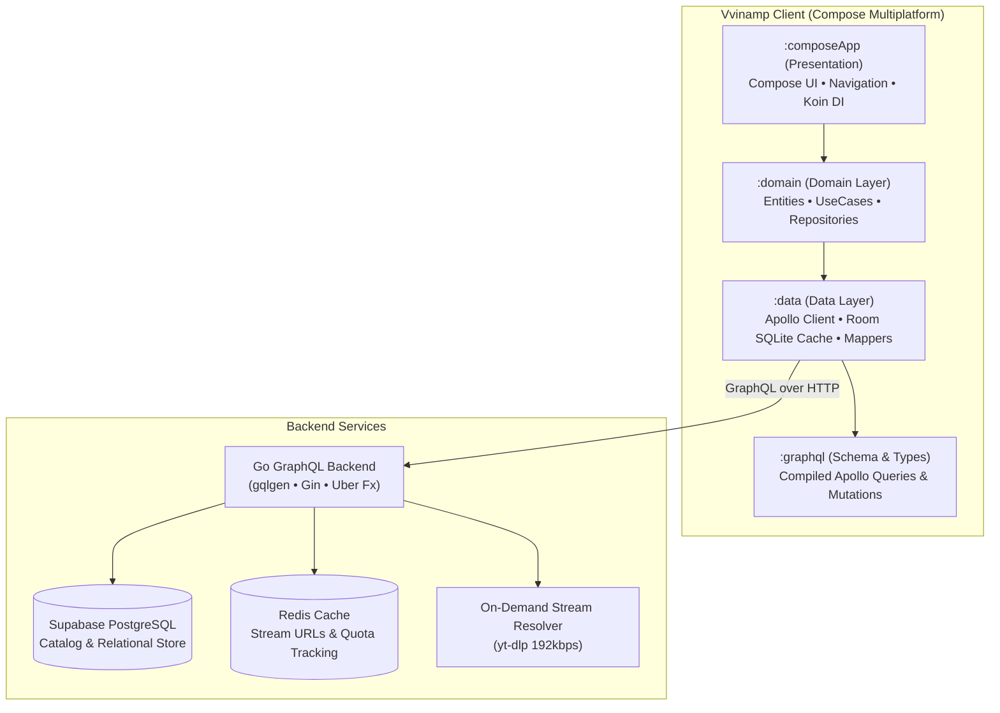

# 🎵 Vvinamp — Cross-Platform Music Streaming Client

[](https://vvinamp.cirio.my.id)
[](https://kotlinlang.org/)
[](https://www.jetbrains.com/lp/compose-multiplatform/)
[](https://www.apollographql.com/docs/kotlin/)
[-black?style=for-the-badge)](https://vvinamp.cirio.my.id)

> A Spotify and Winamp-inspired music streaming application built with **Compose Multiplatform (Android & WebAssembly)**. Features a 100% shared Kotlin UI, a dual-engine streaming player, and resilient search pagination backed by a Go GraphQL backend.

🌐 **Live Web Application:** [https://vvinamp.cirio.my.id](https://vvinamp.cirio.my.id)

---

## 🏗️ Architecture & Data Flow



---

## 🛠️ Multi-Module Structure

The project follows Clean Architecture separated into four distinct Gradle modules:

| Module | Role | Key Technologies |
| :--- | :--- | :--- |
| [`:composeApp`](file:///Users/joel/Programming/jerman/VvinampApp/composeApp) | UI & Presentation layer. Shared Composable screens, design tokens, navigation, platform playback bindings. | Jetpack Compose Multiplatform, Koin ViewModel, Coil 3, Paging 3 Compose |
| [`:domain`](file:///Users/joel/Programming/jerman/VvinampApp/domain) | Pure Kotlin business logic. Platform-agnostic entities, repository contracts, and UseCases. | Kotlin Coroutines, Kotlin Flow |
| [`:data`](file:///Users/joel/Programming/jerman/VvinampApp/data) | Data orchestration. Implements domain repositories, manages local Room SQLite caching, and calls GraphQL endpoints. | Apollo Kotlin, Room (KSP Multiplatform), SQLite |
| [`:graphql`](file:///Users/joel/Programming/jerman/VvinampApp/graphql) | Schema definitions, operations (`.graphql`), and generated Apollo query/mutation types. | Apollo Compiler |

---

## ⚙️ Core Engineering Challenges & Solutions

### 1. WebAssembly (Wasm) Autoplay & Audio Priming
* **Challenge:** Modern desktop and mobile web browsers enforce strict autoplay policies. If audio playback (`HTMLAudioElement.play()`) is initiated after an asynchronous network call (e.g., waiting 1.5s for GraphQL stream resolution), browsers throw `NotAllowedError: play() failed because the user didn't interact with the document first`.
* **Solution:** Implemented synchronous audio gesture priming in `wasmJsMain`. When a track click event is detected, a lightweight `@JsFun` bridge invokes `audioElement.load()` synchronously during the user click gesture before launching the coroutine. Once the backend returns the streaming URL, `.play()` executes without triggering browser autoplay blocks.

### 2. Dual-Engine Playback Resolver
* **Challenge:** The application plays both pre-hosted MP3 catalog tracks and on-demand YouTube streams without hard-coded client branching.
* **Solution:** The client queries a unified `playbackInfo(trackId, contentType, contentId)` GraphQL endpoint. The backend evaluates whether the identifier is a catalog UUID (serving direct Supabase MP3 CDN URLs in $< 2\text{ ms}$) or a YouTube ID (extracting signed 192kbps streams on demand with 4-hour caching). The client seamlessly selects the primary stream or fallback endpoint.

### 3. Resilient Search with 403 Quota Fallback
* **Challenge:** The YouTube Data API v3 enforces a daily quota limit of 10,000 units. When exhausted, direct API search queries fail with HTTP 403 `quotaExceeded`.
* **Solution:** Wired Paging 3 multiplatform streams in `SearchViewModel`. If a 403 error is detected, the UI gracefully switches to the backend's optimized `--flat-playlist` `yt-dlp` pagination stream without crashing or dropping pagination state, and displays an informative banner to the user.

### 4. Just-in-Time (JIT) Playlist Bookmarking
* **Challenge:** Users want to bookmark YouTube tracks into their playlists alongside existing catalog songs without uploading or hosting audio files.
* **Solution:** Built the `AddToPlaylistBottomSheet` flow. When saving a YouTube search result, the client sends track metadata (video ID, title, channel, duration, thumbnail) via `addYoutubeTrackToPlaylist`. The backend verifies or registers a relational track record (`audio_file_url = NULL`, indexed `youtube_id`) and binds it to `playlist_track` with strict foreign key integrity.

---

## 💻 Tech Stack & Libraries

- **UI Toolkit:** [Compose Multiplatform](https://www.jetbrains.com/lp/compose-multiplatform/) (Desktop/Android/Wasm)
- **Language:** [Kotlin 2.1.0](https://kotlinlang.org/)
- **Architecture:** Clean Architecture + MVI/MVVM
- **Dependency Injection:** [Koin Multiplatform](https://insert-koin.io/)
- **API Client:** [Apollo Kotlin 4](https://www.apollographql.com/docs/kotlin/) (GraphQL)
- **Image Loading:** [Coil 3 Multiplatform](https://coil-kt.github.io/coil/)
- **Local Persistence:** [Room Multiplatform](https://developer.android.com/kotlin/multiplatform/room) (SQLite via KSP)
- **Pagination:** [AndroidX Paging 3 Multiplatform](https://developer.android.com/topic/libraries/architecture/paging/v3-overview)
- **Web Deployment:** [Vercel](https://vercel.com/) with custom MIME routing (`vercel.json`) for `.wasm` assets

---

## 🚀 Getting Started

### Prerequisites
- **JDK 17+** (JDK 21 recommended)
- **Android Studio Ladybug / Fleet / IntelliJ IDEA**
- **Node.js 18+** (for Wasm browser webpack tooling)

### Running the Web Version (WasmJs)
```bash
# Start local development server with hot-reload
./gradlew :composeApp:wasmJsBrowserDevelopmentRun

# Build production distribution
./gradlew :composeApp:wasmJsBrowserDistribution
# Artifacts generated at: composeApp/build/dist/wasmJs/productionExecutable
```

#### Previewing the production build locally
The production build is a folder of static files (`index.html` plus `.js` and `.wasm`), the same files deployed to Vercel. Browsers won't load `.wasm` from a `file://` page, so serve the folder over HTTP:

```bash
./gradlew :composeApp:wasmJsBrowserDistribution
python3 -m http.server 8080 --bind 127.0.0.1 --directory composeApp/build/dist/wasmJs/productionExecutable
```

Open http://localhost:8080 and stop the server with Ctrl+C. The local build talks to the live backend, and port 8080 is in the backend's CORS allowlist, so guest login and search work like on the deployed site.

On wide windows the app renders as a centered phone-width column (`PhoneColumnMaxWidth` in `ui/theme/Theme.kt`). Narrow the window to see the full-width phone layout.

### Running the Android App
```bash
# Install and run on connected Android device/emulator
./gradlew :composeApp:installDebug
```

### Running Unit Tests
```bash
# Run unit tests across domain and presentation modules
./gradlew :domain:testAndroidHostTest :composeApp:testAndroidHostTest
```
