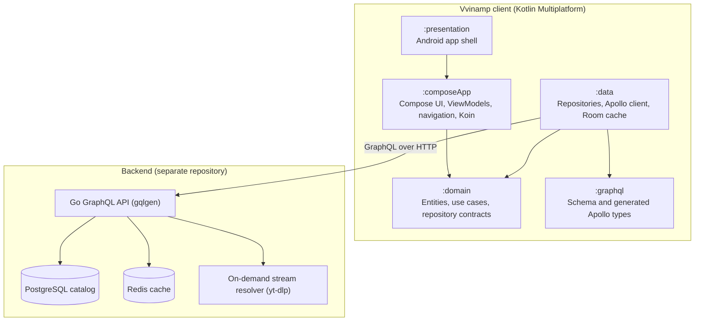

# Vvinamp

A music streaming app built with Kotlin Multiplatform and Compose Multiplatform. One shared Kotlin codebase runs as a native Android app and as a web app compiled to WebAssembly, backed by a Go GraphQL server.

**Live web app:** [vvinamp.vercel.app](https://vvinamp.vercel.app)

Built with Kotlin 2.4, Compose Multiplatform 1.11, Koin, Apollo Kotlin 5 (GraphQL), Ktor, Room, Paging 3, Coil 3 and Media3 ExoPlayer.

## What it does

- **Browse and play music** from a catalog of albums, artists and playlists, with a mini player, a full-screen player, a play queue and a sleep timer.
- **Search** the catalog or YouTube, switching between them on the search screen, with infinite scrolling through Paging 3.
- **Playlists:** create them, upload a cover, and add catalog songs or YouTube results side by side.
- **Listening history** and a personal library.
- **Background playback on Android** through a Media3 `MediaSessionService`, with HLS audio.
- **Web playback** in the browser through an HTML5 audio bridge written with Kotlin/Wasm JS interop.

## Architecture

The app follows Clean Architecture across Gradle modules. UI state flows one way: screens send events to a ViewModel, the ViewModel exposes a single `StateFlow` of UI state.



| Module | Role | Key libraries |
| :--- | :--- | :--- |
| [`:composeApp`](composeApp) | Shared UI for every platform: screens, design tokens, navigation, ViewModels, plus the platform playback code in `androidMain` and `wasmJsMain` | Compose Multiplatform, Koin, Coil 3, Paging 3, Media3 |
| [`:domain`](domain) | Pure Kotlin business logic: entities, use cases, repository interfaces | Coroutines, Flow |
| [`:data`](data) | Implements the domain repositories, calls the GraphQL API, caches locally | Apollo Kotlin, Ktor, Room |
| [`:graphql`](graphql) | GraphQL schema, `.graphql` operations and the generated Apollo types | Apollo compiler |
| [`:presentation`](presentation) | Android application module that hosts the shared UI, with `prod` and `mock` build flavors | Android Gradle Plugin |

Platform-specific behaviour lives behind `expect`/`actual` declarations, so the shared code never branches on the platform.

## Engineering notes

### Playing audio in the browser after a network call
Browsers block `HTMLAudioElement.play()` unless it happens during a user gesture. Resolving a stream URL takes a GraphQL round trip, which is long enough for the browser to stop treating the click as the trigger. The Wasm player calls `load()` on the audio element synchronously inside the click handler, through a small `@JsFun` bridge, and only then starts the coroutine that fetches the URL. When the URL arrives, `play()` is allowed.

### One playback endpoint for two kinds of tracks
Some tracks are hosted MP3 files and some are YouTube videos. The client does not branch on this: it asks a single `playbackInfo(trackId, contentType, contentId)` query, and the backend returns either a direct file URL or a freshly resolved stream URL, plus a fallback.

### One list for two kinds of search results
Catalog songs and YouTube results can share IDs, so the search list keys each row by its kind and ID (`youtube_<id>`). Both kinds go through the same "add to playlist" path in `SearchViewModel`, straight into the target playlist or through a playlist picker.

### Saving YouTube results into playlists
Adding a YouTube result to a playlist sends its metadata (video ID, title, channel, duration, thumbnail) with `addYoutubeTrackToPlaylist`. The backend creates or reuses a track record keyed by the YouTube ID, so playlists can mix catalog songs and YouTube results without storing any audio.

### Browser navigation
On the web, the browser's back and forward buttons are kept in sync with Compose navigation through a JS interop bridge to the History API.

## Tests

ViewModel and logic tests live in `composeApp` (`commonTest`) and `domain`, written with `kotlinx-coroutines-test` and Turbine. They cover the Home, Search, Library, Album, Artist, Auth, Main, Settings and Create Playlist ViewModels, plus helpers such as duration formatting and cover colours.

```bash
./gradlew :domain:testAndroidHostTest :composeApp:testAndroidHostTest
```

Static analysis runs with Detekt (`detekt.gradle`).

## Running it

Requirements: JDK 17 or newer and Android Studio (or IntelliJ IDEA with the Android plugin).

**Web (Wasm), development server with hot reload:**

```bash
./gradlew :composeApp:wasmJsBrowserDevelopmentRun
```

**Web, production build:** the output is a folder of static files (`index.html`, `.js`, `.wasm`), the same files deployed to Vercel. Browsers refuse to load `.wasm` from `file://`, so serve the folder over HTTP:

```bash
./gradlew :composeApp:wasmJsBrowserDistribution
python3 -m http.server 8080 --bind 127.0.0.1 --directory composeApp/build/dist/wasmJs/productionExecutable
```

Then open http://localhost:8080. The local build talks to the live backend, whose CORS allowlist includes port 8080, so guest login and search work as on the deployed site. On wide windows the app renders as a centred phone-width column; narrow the window to see the phone layout.

**Android:**

```bash
./gradlew :presentation:installProdDebug
```

## Status

- Android and web are the working targets. The web version is deployed on Vercel.
- The build also declares iOS targets (`iosArm64`, `iosSimulatorArm64`); the iOS app has not been released.
- Planned: continuous integration on GitHub Actions, UI tests, and a Google Play release.
